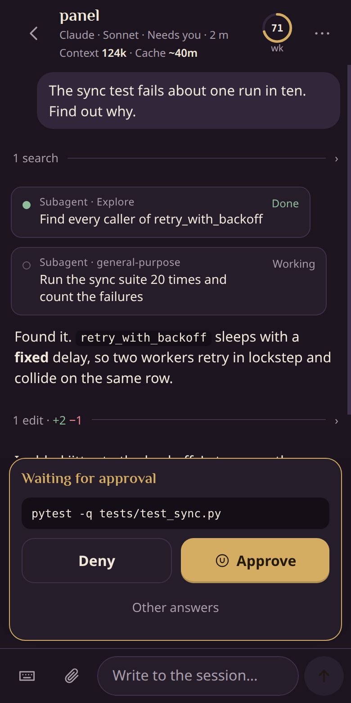
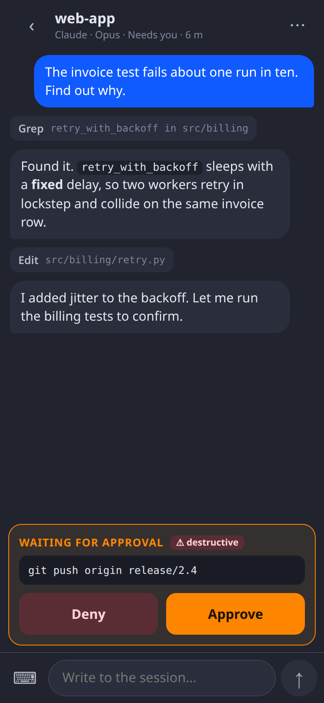
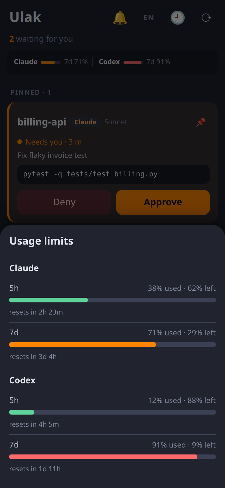

<p align="center">
  
</p>

<h1 align="center">Ulak</h1>

<p align="center">
  <strong>Your coding agents, in your pocket.</strong><br>
  Approve a command, answer a question, send a nudge. Then get back to your coffee.
</p>

Ulak is a small web app (PWA) that turns your [Herdr](https://herdr.dev) agent panes (Claude Code, Codex, Antigravity and plain terminals) into cards and conversations on your phone. Agents keep running on your computer. Ulak is reachable only through your own [Tailscale](https://tailscale.com) network: no account, no relay server, no app store, no build step.

<p align="center">
  
  
  
  
  <br>
  <sub>Demo data from <code>tools/demo_server.py</code>. English and Turkish are built in; the app follows your phone's language and has a TR/EN switch. <a href="docs/screenshots/tr">Turkish screenshots</a>.</sub>
</p>

## What it does

- **See what needs you.** Sessions are grouped as Needs you, Working, Just finished and Idle. Pin the ones you care about; pins live on the server, so every device shows the same list.
- **Approve from the card.** A normal approval takes one tap. The decision is bound to the exact screen you saw: if the prompt changed in the meantime, the server refuses (409) instead of approving something else.
- **Destructive commands need two steps.** `rm`, `git push`, `ssh`, `kubectl delete`, cloud CLIs and your own patterns show the full command and ask for a confirmation token on a second request. Anything too long to fit on screen can only be denied.
- **Read it like a chat.** Claude Code transcripts become messages and tool cards; other agents are parsed from the screen.
- **Answer questions and menus.** Single and multi-select questions, trust dialogs, raw keys when you need them.
- **Attach files.** The paperclip uploads a photo, screenshot, PDF or text file (15 MB max, kept a week) to the server and puts its path in your message; agents read files by path.
- **Push notifications.** Standard Web Push with your own VAPID keys. Nothing goes through a third-party service, nothing fires while the app is open on screen, and quick turns (under two minutes by default) do not buzz your phone when they finish.
- **See your limits.** A strip on the home screen shows the tightest usage window per provider (5-hour and 7-day), turns orange and red as it fills, and opens to resets and staleness. Point it at the files your own scripts already write.
- **English and Turkish.** Follows the phone's language; switch with the TR/EN button. Push text follows the language of each device.
- **Start and close sessions** from the phone (closing is two steps).

## Try it in one minute

No Herdr needed, no setup:

```sh
python3 -m venv .venv && . .venv/bin/activate
pip install -r requirements.txt
python tools/demo_server.py      # http://127.0.0.1:8766
```

## How it compares

| | Ulak | [HerdrChat](https://github.com/cobanov/herdrchat) |
|---|---|---|
| Form | PWA served from your machine | native iOS / Android app |
| Connection | Tailscale Serve, identity checked per request | SSH |
| Install | add to home screen | App Store |
| Approvals | screen-bound, two-step for destructive commands | approval choices |

They solve the same problem from different sides. HerdrChat is the polished native route; Ulak is the one you can read in an afternoon and run without installing anything on the phone.

## Architecture

- `app.py` serves a FastAPI backend on `127.0.0.1:8765` and a static PWA.
- `herdr_client.py` speaks newline-delimited JSON over `~/.config/herdr/herdr.sock`.
- Startup subscribes to the current pane set and adds/removes pane subscriptions as lifecycle events arrive.
- Herdr events flow through the backend to browser clients as Server-Sent Events; the PWA uses REST for reads and actions.
- Push notifications use local VAPID keys and the browser Push API. No relay service is used.

## API

- `GET /api/sessions`: enriched cards, ordered blocked > working > done (<1h) > idle.
- `GET /api/sessions/{pane}/chat`: cleaned screen split into blocks (Claude JSONL when available).
- `POST /api/sessions/{pane}/prompt`: send text. `POST /api/sessions/{pane}/upload`: raw file body (image, PDF or text), returns its server path. `POST /api/quick`: quick send to a configured pane (see Configuration). `GET/PUT /api/pins`: server-side pins, shared across devices.
- `POST /api/sessions/{pane}/approve`: approve/always/deny, bound to the screen fingerprint (409 if it changed; destructive = two steps).
- `POST /api/sessions/{pane}/choose`: pick a menu option (single/multi, trust dialog). `POST .../keys`: raw keys (Enter/approve keys refused on destructive prompts).
- `POST /api/sessions/{pane}/close`: two-step close. `GET /api/projects`, `POST /api/sessions`: start a new session.
- `GET /api/events`: SSE (`session`, `removed`). `GET /api/limits`: `{providers: [{id, label, updated, items: [{label, used, resets_at}]}]}`. `/api/push/*`: public key, subscribe, known, lang.

## Security

The server binds only to `127.0.0.1`; Tailscale Serve is an external deployment step. Requests require the `Tailscale-User-Login` header to match `ULAK_ALLOWED_LOGIN`. Destructive pending commands are checked against a built-in list plus an optional rules file (see Configuration). They require a confirmation token on a second request; normal approvals take one request. This header check assumes the app is reachable only through trusted Tailscale Serve, which strips client-supplied identity headers and supplies its own.

## Run

One command (venv, dependencies, push keys, systemd user service):

```sh
ULAK_ALLOWED_LOGIN=you@github ULAK_VAPID_SUBJECT=mailto:you@example.com ./install.sh
tailscale serve --bg 8765
```

The unit it installs is `deploy/ulak.service.example`. Without systemd, run it by hand:

```sh
python3 -m venv .venv
. .venv/bin/activate
pip install -r requirements.txt
python app.py
```

Set `ULAK_ALLOWED_LOGIN` to the exact Tailscale login before starting. Generate local push keys once with `python tools/generate_vapid.py`; the app serves the public key to the PWA and reads the private key from `.secrets/vapid_private.pem`. Set `ULAK_VAPID_SUBJECT` to a `mailto:` contact for push delivery. Keep `.secrets/` private and untracked. Enable notifications with the button in the app; the browser requires HTTPS (Tailscale Serve) and user permission.

## Configuration

Optional, in `.secrets/config.json` (untracked):

```json
{
  "rules_file": "~/rules.md",
  "quick_targets": ["main-agent"],
  "quick_label": "Main",
  "limit_files": {"claude": "~/limit.json", "agy": "~/agy-usage.txt"},
  "min_work_seconds": 120
}
```

- `rules_file`: extra destructive patterns, one per line as ``- desen: `regex` ``.
- `quick_targets` / `quick_label`: workspace or project names that get the quick-send button.
- `limit_files`: usage-limit files shown in the limits strip. Two formats are understood: JSON `{"h5": {"used_percentage": 4, "resets_at": 1795200600}, "d7": {...}, "ts": 1795183857}` (epoch seconds), or tab-separated text `name<TAB>window<TAB>NN%<TAB>ISO-reset` where NN% is what is *remaining*.
- `min_work_seconds`: a "finished" push is skipped when the turn took less than this (default 120).

State (`.state/`: pins, notification history) lives on the server, so every device sees the same view. Nothing user-specific is stored in the browser except drafts.

## Tests

```sh
pip install pytest && pytest
```

## License

MIT
