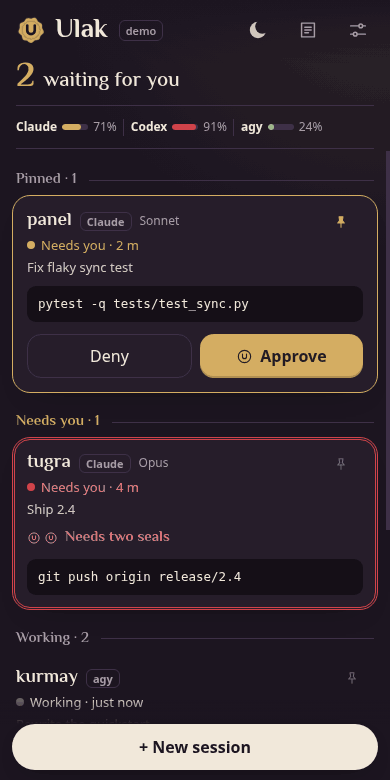
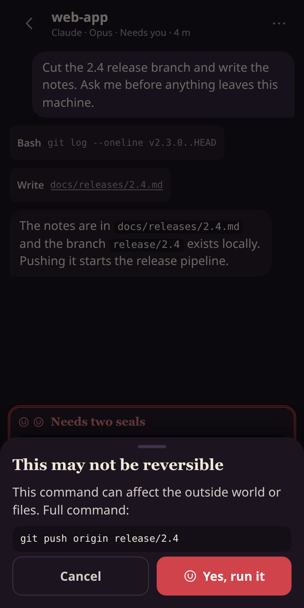
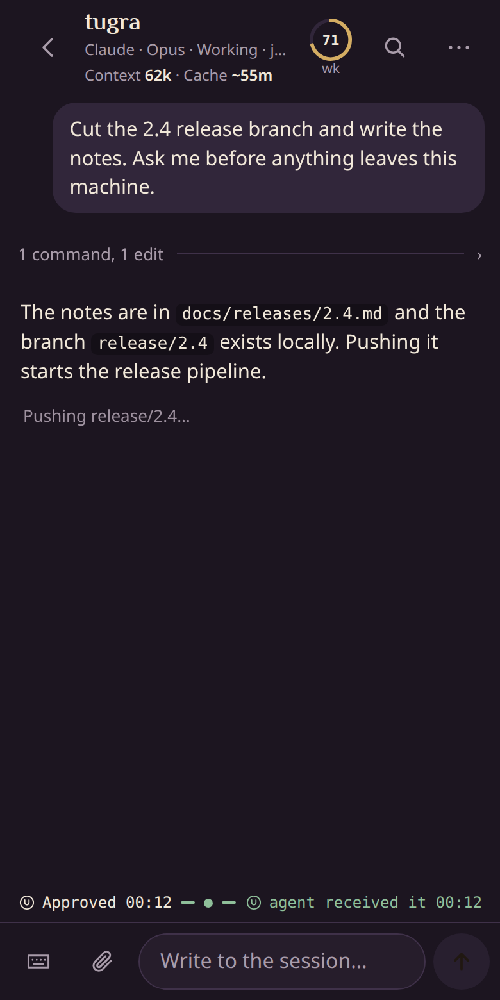
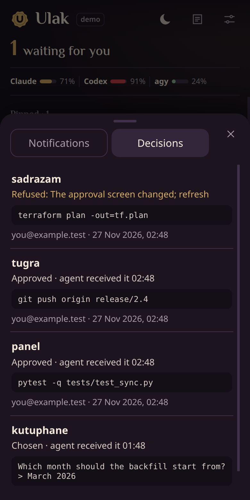

<p align="center">
  
</p>

<h1 align="center">Ulak</h1>

<p align="center">
  <strong>A courier for your coding agents, not a key to your machine.</strong><br>
  The yes goes to the question you read.
</p>

<p align="center"><a href="https://github.com/mtbagatur/ulak/actions/workflows/test.yml"></a></p>



## The problem

An agent stops and asks: *run this?* You are not at your desk. The usual answer is to put a terminal on your phone, which also puts your whole machine on your phone, and a tap on a small screen can land on a question that changed a second ago.

Ulak carries one thing between you and your agents: the answer. It is a small web app (PWA) served from your own computer that shows your [Herdr](https://herdr.dev) panes (Claude Code, Codex, Antigravity) as cards and conversations. It has no terminal. It is reachable only through your own [Tailscale](https://tailscale.com) network: no account, no relay server, no app store, no build step, no telemetry.

## What it does differently

<p align="center">
  
  
  
  
</p>

- **Your yes is bound to what you read.** Every approval carries a fingerprint of the prompt on your screen. If the agent is asking something else by the time your tap arrives, the server answers 409, shows you the new question, and approves nothing.
- **Commands that leave a mark need two seals.** `rm`, `git push`, `ssh`, `terraform apply`, `kubectl delete`, cloud CLIs and your own patterns show the full command and need a second confirmation that expires in two minutes. A command too long to show in full can only be denied.
- **You see the answer arrive.** A line above the composer follows it: sent, on its way, agent received it. If the prompt never leaves the agent's screen, Ulak says so instead of assuming.
- **Everything is on the record.** Each decision, each refusal and each timeout is logged on your machine with who, what and when. Open it from the ledger icon.

## When to pick something else

Ulak is deliberately narrow. These projects solve the same problem with different trade-offs, and each is the better choice for some people.

| | Ulak | [HerdrChat](https://github.com/cobanov/herdrchat) | [ColliePWA](https://github.com/AltanS/collie) | [Ovis](https://github.com/devswha/ovis) |
|---|---|---|---|---|
| Form | PWA served from your machine | native iPhone and iPad app; Android experimental | PWA served from your machine | desktop app, iPhone and Android apps, browser |
| How the phone reaches it | Tailscale Serve only | SSH, usually through Tailscale | Tailscale Serve by default; other front doors documented | Wi-Fi, Tailscale, SSH, or the Ovis end-to-end encrypted relay |
| Account | none | none | none; phones are paired | optional |
| Agents | Claude Code, Codex, Antigravity | Claude Code, Codex, Grok, Antigravity, Pi, OMP | Claude Code, Codex, OpenCode among others | Claude Code, Codex and more |
| Works beside | Herdr | Herdr | Herdr; tmux, zellij and others experimental | Herdr, or its own terminals |
| Terminal on the phone | no; a read-only text view of the agent's screen | yes, a full emulator | types keys into the live pane | yes |
| Approvals | bound to the prompt you read; two steps for destructive commands; decision log | approval choices | the agent's prompts as buttons | cards |
| Usage ping | none | not mentioned | on by default, can be turned off | on by default, can be turned off |

Read from each project's README on 26 November 2026. They move fast; check theirs before deciding.

- **Pick HerdrChat** when you want a native app, a real terminal, subagent and workflow transcripts, an iPad layout, or several computers in one list.
- **Pick ColliePWA** when you use tmux or zellij instead of Herdr, or want built-in voice input, themes and its durable-agent tools.
- **Pick Ovis** when your phone cannot join a tailnet, or you want one app across desktop, phone and browser.
- **Pick Ulak** when you want the phone to be able to answer and little else, every yes tied to the question you read, and code short enough to read before you trust it: about 3,400 lines of Python, JavaScript and CSS and four runtime dependencies.

What Ulak does not do: no terminal, one computer, one person, Herdr only. Conversations are fullest for Claude Code, where the transcript is read directly; other agents are read from the screen.

## What else it does

<p align="center">
  
  
  
  
  <br>
  <sub>Demo data, retaken with <code>python tools/shots.py</code>. <a href="docs/screenshots/tr">Turkish screenshots</a>.</sub>
</p>

- **See what needs you.** Sessions are grouped as Needs you, Working, Just finished (for five minutes) and Idle. Pins live on the server, so every device shows the same list.
- **Read it like a chat.** Claude Code transcripts become messages and tool cards. Subagents show as cards that say what they were asked and whether they are done.
- **Answer questions and menus.** Single and multi-select questions, trust dialogs, and a small key bar (arrows, Esc, Enter, digits) when a prompt needs it.
- **The agent's own slash commands.** Type `/` for the commands and skills that exist on that machine, with a built-in list as fallback.
- **Look without touching.** Agent screen shows the pane as text, Changes shows `git status` and the diff since the last commit. Both are read-only.
- **Attach files.** A photo, screenshot, PDF or text file (15 MB max, kept a week); the agent gets the path.
- **Push notifications.** Standard Web Push with your own VAPID keys. Nothing buzzes while Ulak is on screen, or for turns shorter than two minutes.
- **Usage limits.** A strip shows the tightest window per provider, read from files your own scripts write.
- **Start and close sessions** from the phone (closing takes two steps).
- **English and Turkish**, light and dark; both follow the phone.
- **Dictation** works through your keyboard's microphone. Ulak adds no voice button of its own, so no audio passes through it.

## Try it in one minute

No Herdr needed, no setup:

```sh
python3 -m venv .venv && . .venv/bin/activate
pip install -r requirements.txt
python tools/demo_server.py      # http://127.0.0.1:8766
```

The demo is the real app over a scripted, fake machine that lives in the browser tab (`tools/demo/demo.js`); nothing leaves the tab. Three scenes are worth trying in order:

1. **billing-api**: approve the test run. Ulak moves you to the next session that waits.
2. **web-app**: a `git push` needs two seals. After the second, the line above the composer follows your answer until the agent has it, and the agent resumes.
3. **infra**: a little later a third agent stops. Approve it: the question changed while you were reading, so Ulak refuses your tap, shows the new question, and puts the refusal on the record (ledger icon, Decisions).

`?speed=4` hurries the agents. `python tools/demo_server.py --build DIR` writes the same demo as static files for any web host.

## Security

The server binds to `127.0.0.1` and trusts one thing: the `Tailscale-User-Login` header that Tailscale Serve sets, compared with `ULAK_ALLOWED_LOGIN` on every API request. What that protects, what the fingerprint, the two seals and the log add, and what none of it protects against is in [SECURITY.md](SECURITY.md). Read it before you run Ulak.

## Install

One command (venv, dependencies, push keys, systemd user service):

```sh
ULAK_ALLOWED_LOGIN=you@github ULAK_VAPID_SUBJECT=mailto:you@example.com ./install.sh
tailscale serve --bg 8765
```

The unit it installs is `deploy/ulak.service.example`. Without systemd, run it by hand:

```sh
python3 -m venv .venv
. .venv/bin/activate
pip install -r requirements.txt
python app.py
```

Set `ULAK_ALLOWED_LOGIN` to the exact Tailscale login before starting. Generate local push keys once with `python tools/generate_vapid.py`; the app serves the public key to the PWA and reads the private key from `.secrets/vapid_private.pem`. Set `ULAK_VAPID_SUBJECT` to a `mailto:` contact for push delivery. Keep `.secrets/` private and untracked. Enable notifications with the button in the app; the browser requires HTTPS (Tailscale Serve) and user permission.

## Configuration

Optional, in `.secrets/config.json` (untracked):

```json
{
  "rules_file": "~/rules.md",
  "quick_targets": ["main-agent"],
  "quick_label": "Main",
  "limit_files": {"claude": "~/limit.json", "agy": "~/agy-usage.txt"},
  "project_roots": ["~", "~/code"],
  "min_work_seconds": 120,
  "approval_timeout_minutes": 0
}
```

- `rules_file`: extra destructive regexes, one per line. Blank lines and lines starting with `#` are ignored. Also accepted: markdown list ``- pattern: `regex` ``.
- `quick_targets` / `quick_label`: workspace or project names that get the quick-send button.
- `limit_files`: usage-limit files shown in the limits strip. Two formats are understood: JSON `{"h5": {"used_percentage": 4, "resets_at": 1795200600}, "d7": {...}, "ts": 1795183857}` (epoch seconds), or tab-separated text `name<TAB>window<TAB>NN%<TAB>ISO-reset` where NN% is what is *remaining*.
- `project_roots`: folders whose subfolders appear in the new-session picker (default `["~"]`). New sessions can only start inside your home folder.
- `min_work_seconds`: a "finished" push is skipped when the turn took less than this (default 120).
- `approval_timeout_minutes`: off by default (`0`), so an approval waits for you however long that takes. Set it and Ulak denies an approval nobody answered in that many minutes. It can only deny, only the exact prompt it has been timing, and each one is written to the decision log as a timeout. The clock restarts when Ulak restarts.

State (`.state/`: pins, notification history, the decision log) lives on the server, so every device sees the same view. Nothing user-specific is stored in the browser except drafts.

## Architecture

- `app.py` serves a FastAPI backend on `127.0.0.1:8765` and a static PWA.
- `herdr_client.py` speaks newline-delimited JSON over `~/.config/herdr/herdr.sock`.
- Startup subscribes to the current pane set and adds/removes pane subscriptions as lifecycle events arrive.
- Herdr events flow through the backend to browser clients as Server-Sent Events; the PWA uses REST for reads and actions.
- Push notifications use local VAPID keys and go directly to the browser's Web Push endpoint. The [encrypted payload](https://www.rfc-editor.org/rfc/rfc8291) includes the project label, a short command or output preview, and the pane link. The device can display the preview on its lock screen.

## API

- `GET /api/sessions`: enriched cards, ordered blocked > working > done (five minutes) > unknown > idle.
- `GET /api/sessions/{pane}/chat`: cleaned screen split into blocks (Claude JSONL when available).
- Read-only views: `GET /api/sessions/{pane}/screen` (the pane as text), `.../changes` (`git status` and a size-capped diff of the session's own folder; the phone sends no path), `.../commands` (names and one-line descriptions of the slash commands on the machine).
- `POST /api/sessions/{pane}/prompt`: send text. `POST /api/sessions/{pane}/upload`: raw file body (image, PDF or text), returns its server path. `GET /api/sessions/{pane}/file`: open a supported document inside that workspace. `POST /api/quick`: quick send to a configured pane (see Configuration). `GET/PUT /api/pins`: server-side pins, shared across devices.
- `POST /api/sessions/{pane}/approve`: approve/always/deny, bound to the screen fingerprint (409 if it changed; destructive = two steps).
- `POST /api/sessions/{pane}/choose`: pick a menu option (single/multi, trust dialog). `POST .../keys`: raw keys (Enter/approve keys refused on destructive prompts).
- `POST /api/sessions/{pane}/close`: two-step close. `GET /api/projects`, `POST /api/sessions`: start a new session.
- `GET /api/audit`: the decision log. `GET /api/events`: SSE (`session`, `removed`, `receipt`). `POST /api/presence`: report whether a browser tab is visible. `GET /api/limits`: `{providers: [{id, label, updated, items: [{label, used, resets_at}]}]}`. `/api/push/*`: public key, subscribe, known, lang.

## Tests

```sh
pip install -r requirements.txt -r requirements-dev.txt
python -m pytest -q
```

Browser cases use Chrome or Chromium with a loopback-only fake API. They skip when a browser is unavailable.

## License

MIT
